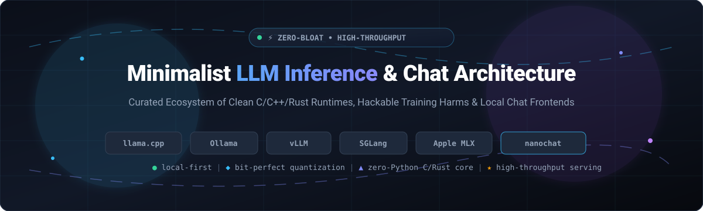

# ⚡ Awesome-Minimalist-LLM-Inference-Chat-Architecture

  

  
  
  
  
  
  
  

## 🚀 Top Minimalist LLM Inference & Chat Architecture Ecosystem

**Curated List of SaaS/Commercial Platforms & Open-Source GitHub Projects**  
*Focused on Minimalist Full-Stack LLM Harnesses (`nanochat`), Lightweight C/C++/Rust Inference Engines, Local Chat Frontends & High-Throughput Serving Runtimes*  
**Last updated: November 2026**

This repository tracks notable **SaaS/commercial platforms** and **open-source projects** for **Minimalist LLM Inference & Chat Architecture**. These tools strip away bloated abstraction layers to deliver clean, hackable end-to-end LLM training-to-chat pipelines (`nanochat`), zero-dependency C/C++/Rust inference engines (`llama.cpp`, `Candle`, `MLX`), ultra-lightweight chat web/CLI interfaces, and high-throughput GPU serving engines.

**Examples** include Ollama, LM Studio, Jan.ai, LocalAI, Text Generation WebUI, llama.cpp, vLLM, Aphrodite Engine, KoboldAI, Exo, and `karpathy/nanochat` (the category leaders).

**Open-source emphasis**: This section is heavily expanded with every major active project for minimalist from-scratch LLM chat architectures (`nanochat`, `llm.c`, `llama2.c`), lean inference engines (`llama.cpp`, `vLLM`, `SGLang`, `MLX`), and fast, dependency-minimal chat frontends (`Open WebUI`, `LibreChat`, `aichat`, `Chatbox`) — ideal for AI researchers, systems hackers, self-hosters, and minimalist software engineers.

Contributions welcome! Open a PR to add/update entries. Keep descriptions factual and link to official sites.

---

## 📑 Table of Contents

- [📊 Sector Overview & Market Dynamics](#-sector-overview--market-dynamics)
- [☁️ SaaS/Commercial Platforms](#️-saascommercial-platforms)
- [💻 Open-Source GitHub Projects](#-open-source-github-projects)
- [🤝 Support](#-support)
- [📈 Star History](#-star-history)
- [🛠️ How to Contribute](#️-how-to-contribute)
- [⚠️ Disclaimer](#️-disclaimer)

---

## 📊 Sector Overview & Market Dynamics

The global AI inference market is estimated at **$103B–$113B in 2025** and projected to exceed **$117B–$133B in 2026**, expanding rapidly as enterprise generative AI moves from training to production. The market dynamics exhibit a barbell structure: highly concentrated and capital-intensive at the foundational hardware and hyperscale compute layer (dominated by NVIDIA and CSPs), but moderately-to-highly fragmented across inference routing, model serving runtimes, and local/desktop chat frontend applications where niche performance optimizations and UI ergonomics thrive.

---

## ☁️ SaaS/Commercial Platforms

| Platform | Valuation / Revenue Scale | Pricing (Starting Tier) | Free Tier Limits / Free Trial | Description |
| :--- | :--- | :--- | :--- | :--- |
| **[GroqCloud](https://groq.com)** | **$6.9B Valuation** ($750M Series E, 2025; $90M 2024 revenue / $500M target) | $0.05 / 1M tokens (LPU serverless pay-per-token starting rate for small models) | Free forever tier: 30 requests/min (RPM), 1,000 requests/day (RPD), and 8,000–30,000 tokens/min (TPM) limit per model | Ultra-low-latency LPU inference cloud delivering near-instant token generation for open-weights LLMs via an OpenAI-compatible REST API. |
| **[Fireworks AI](https://fireworks.ai)** | **$4.0B+ Valuation** ($250M Series C, 2025; later $17.5B in 2026) | $0.10 / 1M tokens (Flash models serverless pay-per-token starting rate) | $1 free trial credits on sign-up (no credit card required; strict RPM rate limits without payment method) | High-speed generative AI inference cloud optimized for low-latency open-model serving, structured JSON outputs, and custom LoRA deployment. |
| **[Together AI](https://together.ai)** | **$3.3B Valuation** (Series B, 2025; $8.3B Series C in 2026) | $0.10 / 1M tokens (serverless pay-per-token; requires $15 initial minimum prepaid credit purchase) | No permanent free tier or automatic free trial (requires $15 minimum prepaid deposit; free credits available via formal Startup Accelerator application) | Cloud inference and fine-tuning platform hosting fast, quantized and full-precision open-weights chat models with serverless and dedicated endpoints. |
| **[OpenRouter](https://openrouter.ai)** | **$1.3B–$1.5B Valuation** ($140M–$160M ARR, $166M raised) | $0.00 / 1M tokens (Free-tier models); paid models billed at upstream pass-through + ~5.5% routing fee | Free tier forever on `:free` models: 20 requests/min (RPM) and 50 requests/day (RPD) (increases to 1,000 RPD after $10 lifetime credit deposit) | Unified cloud inference router providing a single OpenAI-compatible API endpoint across hundreds of proprietary and open-weights chat models. |
| **[LM Studio](https://lmstudio.ai)** | **$102M Valuation** (~$19.3M total venture funding raised) | $0.00 (Free for personal and commercial/enterprise use; custom pricing for LM Studio Bionic/enterprise deployments) | Free forever: 100% full local app and CLI/headless server features with unlimited local chats and tokens (compute limited only by local hardware) | Commercial-friendly desktop local LLM runner, GGUF/MLX model browser, and OpenAI-compatible local server featuring a clean chat UI and zero-config hardware acceleration. |
| **[GPT4All (Nomic AI)](https://nomic.ai)** | **$100M Valuation** ($17M total venture funding raised by Nomic AI) | $0.00 (GPT4All client is free open-source; Nomic AI cloud platform starts at $20/month for Individual plan) | Free forever: 100% unrestricted offline local chats, LocalDocs embeddings, and model downloads (no token or time limits; runs entirely on-device) | Privacy-focused desktop chat client and local model ecosystem enabling offline LLM conversations and local document search on consumer hardware. |
| **[TypingMind](https://typingmind.com)** | **$1.5M–$2.0M ARR** (Bootstrapped / profitable indie business) | $39 one-time lifetime license (Standard personal plan; Teams plan from $99/month) | Free web tier: basic BYOK chat interface, but chat history is not saved locally/synced and advanced features (Artifacts, Canvas, Plugins) are restricted | Clean, client-side web and desktop chat frontend connecting to local Ollama/LM Studio servers and cloud LLM APIs with prompt libraries and folders. |
| **[Msty](https://msty.app)** | **Bootstrapped** (Private indie venture, self-funded) | $149/year or $349 one-time lifetime (Aurum commercial license; required for business/workplace usage) | Free forever tier: strictly for personal, non-commercial use only (includes local/API chat, local RAG knowledge stacks, and split chats) | Commercial-friendly local-first desktop AI chat studio supporting offline GGUF models, Ollama integration, split chats, and local RAG knowledge stacks. |

---

## 💻 Open-Source GitHub Projects

*Sorted in descending order by GitHub_Stars.*

- **[ollama/ollama](https://github.com/ollama/ollama)**   
  The most popular open-source local LLM runtime and REST API server offering one-command model pulls, Modelfile customization, GPU offloading, and clean CLI/desktop chat.

- **[open-webui/open-webui](https://github.com/open-webui/open-webui)**   
  Feature-rich, self-hosted open-source web chat interface built for Ollama and OpenAI-compatible backends with offline PWA support, RAG, Web search, and multi-model arenas.

- **[ggml-org/llama.cpp](https://github.com/ggml-org/llama.cpp)**   
  The foundational, dependency-minimal open-source C/C++ LLM inference engine and built-in `llama-server` web chat UI supporting CPU, CUDA, Metal, Vulkan, and ROCm.

- **[vllm-project/vllm](https://github.com/vllm-project/vllm)**   
  High-throughput, memory-efficient open-source LLM inference and serving engine powered by PagedAttention and continuous batching.

- **[lobehub/lobe-chat](https://github.com/lobehub/lobe-chat)**   
  Modern, open-source AI chat workspace and super-agent framework supporting multi-modal models, local Ollama endpoints, visual plugin ecosystem, and mobile PWA.

- **[karpathy/nanoGPT](https://github.com/karpathy/nanoGPT)**   
  The simplest, fastest repository for training and finetuning medium-sized GPTs by Andrej Karpathy, prioritizing radical clarity and pedagogical minimalism in ~300 lines of PyTorch.

- **[karpathy/nanochat](https://github.com/karpathy/nanochat)**   
  Minimalist, clean, full-stack open-source LLM repository by Andrej Karpathy covering the entire pipeline from tokenization, pretraining, and midtraining/SFT to RL and a web chat UI in readable, hackable code.

- **[mudler/LocalAI](https://github.com/mudler/LocalAI)**   
  Drop-in open-source OpenAI-compatible local inference server running LLMs, embeddings, TTS, STT, and image models on consumer CPU/GPU hardware without cloud dependencies.

- **[exo-explore/exo](https://github.com/exo-explore/exo)**   
  Open-source peer-to-peer distributed inference engine uniting everyday devices (Macs, Linux PCs, phones) over LAN to shard and run large LLMs collaboratively.

- **[oobabooga/text-generation-webui](https://github.com/oobabooga/text-generation-webui)**   
  Modular open-source Gradio web interface supporting `llama.cpp`, `Transformers`, `ExLlamaV2`, `TensorRT-LLM`, and character/instruct chat modes.

- **[LibreChat-AI/LibreChat](https://github.com/LibreChat-AI/LibreChat)**   
  Sleek, open-source ChatGPT clone supporting local `llama.cpp`/Ollama endpoints alongside cloud providers, artifacts, code interpreter, and MCP tools.

- **[janhq/jan](https://github.com/janhq/jan)**   
  Open-source, offline-first ChatGPT desktop alternative powered by `llama.cpp` with a clean interface, local OpenAI-compatible API server, and zero telemetry.

- **[chatboxai/chatbox](https://github.com/chatboxai/chatbox)**   
  Polished, cross-platform open-source desktop and mobile AI chat client connecting directly to local Ollama, `llama-server`, and OpenAI-compatible inference backends.

- **[sgl-project/sglang](https://github.com/sgl-project/sglang)**   
  Ultra-fast open-source serving framework for large language and vision-language models featuring RadixAttention prefix caching and zero-overhead structured decoding.

- **[karpathy/llm.c](https://github.com/karpathy/llm.c)**   
  Ultra-minimalist, pure C/CUDA open-source LLM training and inference implementation in clean, dependency-free code without PyTorch bloat.

- **[ml-explore/mlx](https://github.com/ml-explore/mlx)**   
  Clean, NumPy-like open-source array framework from Apple ML Research delivering peak local LLM inference and fine-tuning throughput on Apple Silicon unified memory.

- **[mozilla-ai/llamafile](https://github.com/mozilla-ai/llamafile)**   
  Open-source project by Mozilla Ocho packaging `llama.cpp` and model weights into a single cross-platform, double-clickable cosmopolitan executable with an embedded chat UI.

- **[huggingface/candle](https://github.com/huggingface/candle)**   
  Minimalist open-source machine learning framework for Rust engineered for serverless, lightweight, zero-Python LLM inference on CPU, CUDA, Metal, and WebAssembly.

- **[karpathy/llama2.c](https://github.com/karpathy/llama2.c)**   
  Inference Llama 2 architecture in ~700 lines of pure, dependency-free C with zero external packages or bloat.

- **[LostRuins/koboldcpp](https://github.com/LostRuins/koboldcpp)**   
  Single-file, zero-install open-source C/C++ executable built on `llama.cpp` bundling a rich local chat/storytelling UI (`KoboldAI Lite`), image generation, and OpenAI-compatible APIs.

- **[sigoden/aichat](https://github.com/sigoden/aichat)**   
  All-in-one, blazing-fast open-source CLI LLM chat tool written in Rust supporting REPL mode, shell assistant, local RAG, and 20+ local/cloud providers.

- **[ml-explore/mlx-lm](https://github.com/ml-explore/mlx-lm)**   
  Python package built directly on Apple MLX for generating, converting, quantizing, and serving open LLMs locally with high speed on Apple Silicon.

- **[turboderp-org/exllamav2](https://github.com/turboderp-org/exllamav2)**   
  Ultra-fast open-source inference library specifically crafted for running quantized EXL2 language models on modern consumer-class NVIDIA GPUs.

- **[ikawrakow/ik_llama.cpp](https://github.com/ikawrakow/ik_llama.cpp)**   
  High-performance open-source `llama.cpp` fork featuring cutting-edge IQ quantization formats and CPU/hybrid MoE inference speedups.

- **[dphnAI/sonar](https://github.com/dphnAI/sonar)**   
  High-throughput open-source inference engine (formerly Aphrodite Engine) built on vLLM with extensive quantization support (`EXL2`, `AWQ`, `GPTQ`, `GGUF`, `FP8`) and creative samplers.

- **[theroyallab/tabbyAPI](https://github.com/theroyallab/tabbyAPI)**   
  Official lightweight OpenAI-compatible API server powered by ExLlamaV2, providing blazingly fast local inference and low VRAM footprint.

---

### 💡 Frameworks for Building Custom Systems

Combine **karpathy/nanochat** (minimalist full-stack architecture), **llama.cpp / MLX / vLLM** (inference runtime), **Ollama** (model management), and **Open WebUI / AIChat** (web or terminal chat UI) for a fast, transparent, zero-bloat LLM stack.

---

## 🤝 Support

Thank you for exploring this curated repository! If you find this guide helpful, please consider:
- ⭐ **Starring** the repository on GitHub
- 🍴 **Forking** and contributing your own improvements
- 📢 **Sharing** with friends, colleagues, and community forums

Your encouragement and contributions keep this directory up-to-date with the fast-evolving minimalist LLM inference landscape!

☕ **Buy Me a Coffee / Sponsor**: Support ongoing maintenance and open-source curation via the [GitHub Sponsor Dashboard](https://github.com/sponsors/ishandutta2007).

---

## 📈 Star History

  

---

## 🛠️ How to Contribute

1. Fork the repo.
2. Add/edit entries in `README.md` (follow the existing format and tables).
3. Include: name, link, 1–2 sentence description, and whether it's SaaS or open-source.
4. Submit a PR with a short explanation.

Star the repo if you find it useful!

---

## ⚠️ Disclaimer

- This is a **community-curated** list — not exhaustive and not an endorsement.
- Exposing local inference servers (`llama-server`, `Ollama`, `vLLM`, `Open WebUI`) on `0.0.0.0` without authentication or firewall rules allows anyone on your network or the public internet to consume your GPU compute or read chat histories; always bind to `127.0.0.1` or place behind an authenticated reverse proxy.
- Always verify SHA-256 checksums and prefer safe serialization formats (`Safetensors`, `GGUF`) over arbitrary Python `pickle` checkpoints when downloading open-weights models.

---

**Made with ❤️ for AI researchers, systems hackers, self-hosters, and minimalist software engineers.**  
*Let's make LLM inference and chat architectures cleaner, faster, and open.*
